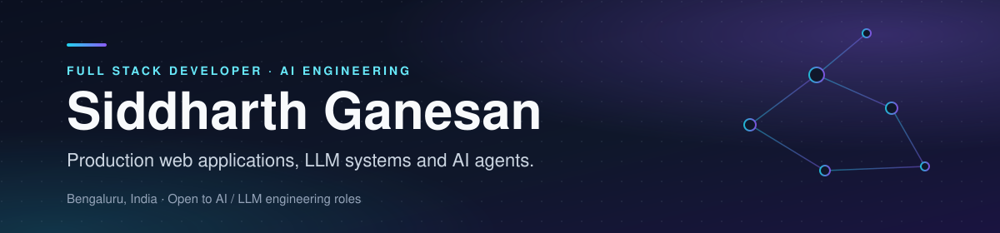

  <a href="https://siddharthganesan.netlify.app/"><b>Portfolio</b></a> &nbsp;·&nbsp;
  <a href="https://www.linkedin.com/in/siddharth180/"><b>LinkedIn</b></a> &nbsp;·&nbsp;
  <a href="mailto:siddharthganesan66@gmail.com"><b>Email</b></a>

 

## About

Full Stack Developer with 2+ years of experience building production applications on the MERN stack, now moving into AI engineering. I build LLM applications, RAG pipelines and multi-agent systems, and I measure what I build.

At Vyapini Tech Services I work on an enterprise application with 83,000+ records and modules used by 1,000+ people.

 

## Current focus

- LLM applications and AI API integration
- Retrieval-augmented generation with hybrid retrieval
- AI agents and multi-agent systems
- Evaluating answer quality and reliability
- Backend engineering for production-ready applications

 

## Technical skills

<table>
  <tr>
    <td width="150"><b>Languages</b></td>
    <td>
      
      &nbsp;<code>SQL</code>
    </td>
  </tr>
  <tr>
    <td><b>Frontend</b></td>
    <td>
      
      &nbsp;<code>Streamlit</code>
    </td>
  </tr>
  <tr>
    <td><b>Backend</b></td>
    <td>
      
      &nbsp;<code>REST APIs</code>
    </td>
  </tr>
  <tr>
    <td><b>AI / ML</b></td>
    <td>
      <code>LLMs</code> <code>RAG</code> <code>LangGraph</code> <code>Multi-Agent Systems</code>
      <code>Embeddings</code> <code>Vector Databases</code> <code>Prompt Engineering</code> <code>AI API Integration</code>
    </td>
  </tr>
  <tr>
    <td><b>Databases</b></td>
    <td>
      
      &nbsp;<code>Qdrant</code>
    </td>
  </tr>
  <tr>
    <td><b>Cloud &amp; DevOps</b></td>
    <td>
      
      &nbsp;<code>CI/CD</code>
    </td>
  </tr>
  <tr>
    <td><b>Tools</b></td>
    <td>
      
    </td>
  </tr>
</table>

 

## Featured projects

### [Smart AI Router](https://github.com/Siddharth354/SmartAiRouter)

Routes simple queries to lightweight models and complex ones to advanced models, cutting LLM API cost while keeping response quality.

- Complexity classification and intent analysis choose the model that answers
- Confidence-based fallback when the lightweight model is unsure
- Every routing decision is logged to Supabase with its metrics

`Python` `FastAPI` `React` `Supabase` `LLM APIs`

[Live demo](https://smart-ai-router.vercel.app) &nbsp;·&nbsp; [Source code](https://github.com/Siddharth354/SmartAiRouter)

 

### [Argus: Multi-Agent Deep Research Engine](https://github.com/Siddharth354/ARGUS)

An asynchronous research system: a planner splits the question, parallel searchers gather evidence, and a synthesizer writes a cited answer.

- Owned agent loop with turn, token, time and cost budgets
- Hybrid retrieval (dense and full-text, fused with Reciprocal Rank Fusion) on pgvector, able to run locally on Ollama
- Eval gate in CI: the build fails if any of 8 quality metrics drops below its threshold on a 48-question benchmark

`Python` `Async` `pgvector` `Ollama`

[Source code](https://github.com/Siddharth354/ARGUS)

 

### [LegalFriend: Voice-First Multilingual Legal AI](https://github.com/Siddharth354/LegalFriend)

A multilingual assistant for legal information with voice in and voice out. It answers from retrieved legal text and abstains when it cannot verify a claim.

- RAG with parallel dense and BM25 retrieval on Qdrant
- Multi-step LangGraph workflow with advocate, critic and judge stages
- Speech-to-text, translation and text-to-speech streamed to a Next.js app

`Python` `FastAPI` `Next.js` `LangGraph` `Qdrant`

[Source code](https://github.com/Siddharth354/LegalFriend)

 

## GitHub statistics

 

## Contribution activity

 

## Connect

Open to AI and LLM engineering roles. LinkedIn or email is the quickest way to reach me.

<a href="https://siddharthganesan.netlify.app/"><b>Portfolio</b></a> &nbsp;·&nbsp;
<a href="https://www.linkedin.com/in/siddharth180/"><b>LinkedIn</b></a> &nbsp;·&nbsp;
<a href="mailto:siddharthganesan66@gmail.com"><b>Email</b></a>

